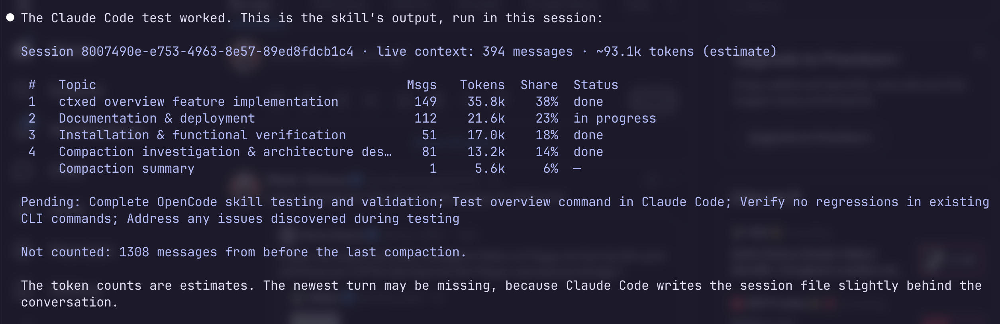
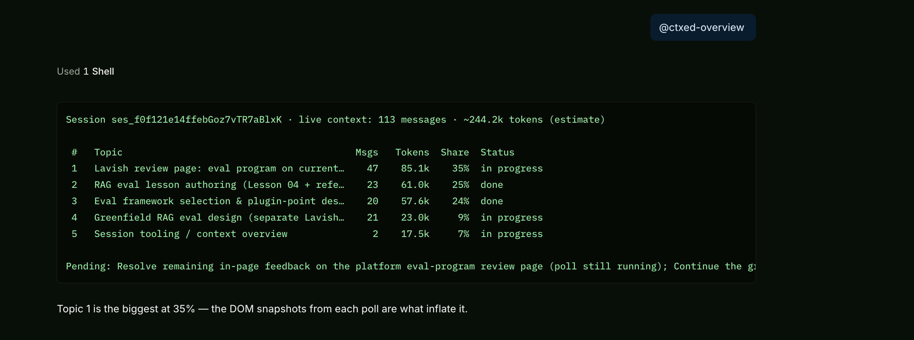

# ctxed

[](https://github.com/simranjeetc/ctxed/actions/workflows/ci.yml)
[](https://github.com/simranjeetc/ctxed/releases/latest)
[](go.mod)
[](LICENSE)

See what an agent session's **context** is made of: which topics it holds, how
many tokens each takes, which are done, and what is still pending. Works the same
in Claude Code and OpenCode. Read-only — ctxed never changes a session.




## Use it

Ask your agent:

> what's in my context?

or invoke the skill directly with `/ctxed-overview`. The agent runs `ctxed
overview` and shows the table as printed.

```
Session 7f3c9a21-… · live context: 37 messages · ~16.7k tokens (estimate)

 #   Topic                          Msgs   Tokens  Share  Status
 1   Auth middleware refactor          12     5.0k    30%  in progress
 2   Test fixtures and CI               9     3.8k    22%  done
 3   Docs and screenshots               8     3.3k    20%  in progress
 4   Token-refresh race                 7     2.9k    17%  done
     Compaction summary                 1     1.7k    10%  —

Pending: Finish the docs pass; Decide whether to unpark prune

Not counted: 12 messages from before the last compaction.
```

## Install

```sh
curl -fsSL https://github.com/simranjeetc/ctxed/releases/latest/download/install.sh | sh
```

Installs the `ctxed-overview` skill for Claude Code and OpenCode. Restart
OpenCode after installing — it loads skills at start.

## What you're looking at

| Column | Meaning |
| --- | --- |
| Topic | A group of related messages, named by a cheap model call |
| Msgs | Messages in that topic |
| Tokens | Estimated size (roughly one token per four characters) |
| Share | Fraction of the live context |
| Status | `done`, `in progress`, or `—` for the compaction row |

- **Live context only** — the entries after the last compaction. The compaction
  is its own row; *Not counted* is the history it replaced.
- **Pending** — what the session had left open at the time.
- Names and counts are the model's reading of the session, so treat them as a
  good estimate, not exact bookkeeping.

## How it works

```
 Claude Code .jsonl ─┐                       ┌─ tokenizer: chars/4 estimate,
                     ├─► adapter ─► live ────┤    or tiktoken via --tokenizer
 OpenCode export ────┘   (claude/  context   │
                          opencode) (after   └─ categorizer: one cheap model call
                                    last          names ≤5 topics + status + pending
                                    compaction)            │
                                                           ▼
                                   overview: every entry in exactly one row,
                                   rows sum to the session total ─► table / --json
```

## Design choices

- **Read-only.** ctxed never edits a transcript; it reads the file or the harness export.
- **No shipped model.** The topic model resolves from flag → env → the session's own
  model → harness config, and errors naming every source it tried
  ([`docs/cli.md`](docs/cli.md#which-model-names-the-topics)). A binary never silently
  calls a provider it was built with.
- **Sizes survive model failure.** If the categorizer fails, token sizes still print
  as one row; `--no-model` sends nothing anywhere.
- **Estimate by default.** chars/4 is cheap and harness-neutral; `--tokenizer` opts into
  an exact count.
- **Live context only.** Entries before the last compaction are reported as *Not
  counted*, because the model no longer sees them.

## Development

```sh
go test ./...                            # offline, deterministic
scripts/verify-functionally.sh --all     # real Claude Code + OpenCode sessions, cheap models
```

Command-line reference (every command and flag): [`docs/cli.md`](docs/cli.md).
